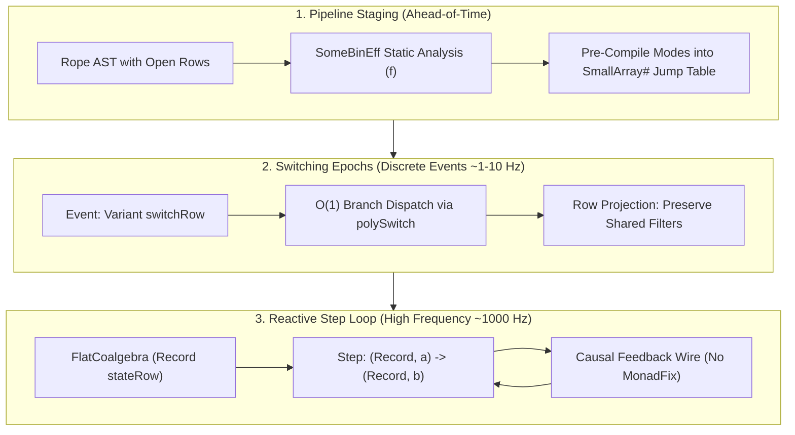

# Architectural Assessment: Algebraic Effects in FRP & Polytropos-Backed Kernmantle

**Status:** ARCHITECTURAL ASSESSMENT & IMPLEMENTATION PROPOSAL  
**Date:** October 2026  
**Context:** Evaluation of [`docs/transcripts/gemini-algebraic-effects-in-FRP.md`](../transcripts/gemini-algebraic-effects-in-FRP.md) for the `polytropos-port` branch of `kernmantle`.  
**Target Repository:** [`/home/nyc/src/kernmantle`](file:///home/nyc/src/kernmantle) (`polytropos-port` branch)  

---

## 1. Executive Summary

The transcript [`docs/transcripts/gemini-algebraic-effects-in-FRP.md`](../transcripts/gemini-algebraic-effects-in-FRP.md) addresses a foundational question in declarative programming: **Can the binary algebraic effect system of Kernmantle be reconciled with high-frequency, stateful Arrowized Functional Reactive Programming (AFRP)?**

Historically, the answer has been negative. Kernmantle’s free-arrow `Rope` was engineered for **macroscopic, one-shot task pipelines** (e.g. data science workflows in Tweag's *Porcupine*). Stepping a `Rope` GADT on every clock tick (60 Hz to 1,000 Hz) incurs severe heap allocation overhead and destroys GHC arrow-law fusion. Furthermore, Yampa-style dynamic switching (`switch :: SF a (b, Event c) -> (c -> SF a b) -> SF a b`) buries future topologies inside opaque Haskell closures (`c -> Rope ...`), blinding Kernmantle's ahead-of-time static analysis (`SomeBinEff f`).

However, the transcript demonstrates that this incompatibility is not fundamental. It stems from conflating three distinct timescales:
1. **Pipeline Staging (Compile-Time / Initialization):** Whole-graph static analysis, resource footprint calculation, and dependency validation.
2. **Switching Epochs (Discrete Events, Low Frequency ~1–10 Hz):** Coarse-grained behavioral mode changes (e.g. robot switching from *docking* to *navigation*).
3. **Reactive Sample Ticks (High Frequency ~60–1,000 Hz):** Pure coalgebraic state stepping.

Crucially, **rebasing Kernmantle onto Polytropos provides the exact memory and type-level primitives required to fuse these timescales**. By exploiting Polytropos's $O(1)$ `SmallArray#` memory layouts, OCaml-style row-tail closure, and dual open variants/records, we can transform Kernmantle into an ultra-high-performance, statically verifiable reactive arrow engine.

This document reviews the transcript in detail, audits the current state of the `polytropos-port` branch, and establishes a prioritized roadmap for implementation.

---

## 2. Technical Synthesis of the Transcript

### 2.1 The Binary Effect Advantage & The Coalgebraic Dilemma

Almost all modern Haskell effect systems (`effectful`, `fused-effects`, `polysemy`, `bluefin`) model **unary effects** of kind `Type -> Type` (`Eff es a`), generalizing Monads. Kernmantle stands alone in modeling **binary effects** of kind `Type -> Type -> Type` (`eff a b`), generalizing Profunctor, Category, and Arrow.

```
       Unary Effects (eff a)                 Binary Effects (eff a b)
  [polysemy, effectful, fused-effects]              [kernmantle]
          Monad-centric                             Arrow-centric
   Computation produces value 'a'        Computation transforms 'a' into 'b'
     Opaque internal dataflow               Explicit input/output topology
```

In an FRP context, binary effects offer major architectural advantages:
* **Preserving Arrow Topology Without `ArrowApply`:** `Rope` intentionally omits `ArrowApply` (which collapses arrows back into monads), keeping the signal graph statically inspectable.
* **Pre-Flight Static Analysis via `SomeBinEff f w m a b`:** The decomposition $f (w\ a \to m\ b)$ allows an Applicative functor $f$ to statically inspect all hardware requirements, sensor allocations, and clock domains before the system begins running.
* **Multi-Interpretation (`entwine`):** The exact same signal processing graph can be interpreted into live hardware execution, deterministic replay debugging, or a visual block diagram.

#### Why Stock Kernmantle Struggles in High-Frequency FRP

```
+-----------------------------------------------------------------------------+
| Macroscopic Pipeline (Stock Kernmantle)                                     |
| Input A =====> [Eff 1] =====> [Eff 2] =====> [Eff 3] =====> Output B        |
| (One-shot execution, entwine folds GADT once at startup)                    |
+-----------------------------------------------------------------------------+
                                     VS
+-----------------------------------------------------------------------------+
| Coalgebraic FRP Step Loop (Yampa / Dunai / Rhine)                           |
|                  +-----------------------+                                  |
|                  |                       | State S_t+1                      |
|                  v                       |                                  |
| Sample A_t ===> [ Single-Tick Transition ] ===> Sample B_t                  |
|                  (Stepped 60x - 1,000x per second!)                         |
+-----------------------------------------------------------------------------+
```

1. **GADT Traversal Tax:** If `entwine` is invoked on each tick, the free-arrow AST must be re-interpreted every millisecond, allocating dozens of heap objects per tick and triggering continuous GC pressure.
2. **The Switching Closure Paradox:** In Yampa, `switch` takes `c -> SF a b`. Because the continuation is a raw Haskell function awaiting a runtime value $c$, `SomeBinEff` cannot traverse inside it at compile time.
3. **The `ArrowLoop` Knot:** Expressing feedback in pure arrows requires `ArrowLoop` (`loop :: arr (a, d) (b, d) -> arr a b`). In an effectful setting, this requires `MonadFix m` (`mfix`), which bottoms out (`<<loop>>`) whenever effects are strict or side-effecting.

---

### 2.2 The Four Concrete Architectural Solutions

The transcript outlines four complementary strategies to resolve these issues:



#### Strategy 1: Compile-per-Epoch Staging (`Kern = MSF m`)
* Separate steady-state sample ticks from discrete mode transitions.
* Set the core arrow type `core` to Dunai’s Monadic Stream Function:
  ```haskell
  newtype MSF m a b = MSF { unMSF :: a -> m (b, MSF m a b) }
  ```
* During an epoch, step the compiled `MSF m a b` directly with **zero GADT overhead**.
* On a discrete event (caught via `ExceptT`), run `entwine` **once** to compile the incoming branch, then resume stepping.

#### Strategy 2: Existential State-Lens Extraction (`MealyEff` / `FlatCoalgebra`)
* Allow strands to declare encapsulated internal state via an existential Mealy strand:
  ```haskell
  data MealyEff eff a b where
    MealyStrand :: s -> (s -> a -> eff (b, s)) -> MealyEff eff a b
  ```
* During `entwine`, extract and fold all existential states $s_1, s_2, \dots$ into a single composite state record.
* **Interpreter Hot-Swapping:** Because the composite state is decoupled from the effect interpreter, a running system can be paused, its state record saved, and resumed under a deterministic simulation or debugging interpreter without losing accumulator state.

#### Strategy 3: Parameterized & Dual Row-Typed Switching (`polySwitch`)
* Eliminate opaque closures `c -> Rope a b` by structuring dynamic switching as a **row duality**:
  1. The switching event is an open variant: `Variant sw`, where each label carries mode parameters $c_i$.
  2. The switch table is a dual open record of parameterized arrow templates:
     ```haskell
     Record (TemplateBranches mantle kern a b sw)
     -- where each field #label holds: Rope mantle kern (c_i, a) b
     ```
* **100% Static Analysis:** `SomeBinEff` folds Applicative analyzer $f$ across the concrete record of templates ahead of time.
* **$O(1)$ Jump Table Dispatch:** In Polytropos, open variants and open records share identical tag offsets, reducing mode switching to a single `indexSmallArray#` operation.
* **Row-Polymorphic State Continuity:** When switching from `mode1` to `mode2`, shared state fields (e.g. low-pass filter accumulators) are preserved by projecting `SubRow` fields from the old state record into the new state record.

#### Strategy 4: Causal Feedback Strand (`FeedbackEff`)
* Replace `ArrowLoop` with a first-class causal feedback strand:
  ```haskell
  data FeedbackEff r a b where
    Feedback :: s -> r (a, s) (b, s) -> FeedbackEff r a b
  ```
* Because input $s_t$ is determined at tick $t-1$, the step executes strictly from left to right.
* Requires **zero `MonadFix`**, never creates lazy thunks, and inspects linearly in `SomeBinEff`.

---

## 3. Current State of `polytropos-port` in Kernmantle

The `polytropos-port` branch of `kernmantle` has already achieved significant milestones in replacing Vinyl with Polytropos:

1. **Core Rope Representation (`Control.Kernmantle.Rope.Internal`)**:
   - Replaced Vinyl's $O(N)$ linked-list `Rec` and Peano-indexed `CoRec` with Polytropos row structures.
   - Grounded `Rope` arrow constructors over Polytropos `Record` bundles.
2. **$O(1)$ Variant Routing (`Control.Kernmantle.Rope.Variant`)**:
   - Implemented `VariantRouter` backed by `Data.Primitive.SmallArray`.
   - Introduced `routeVariantWith` and `branchRope` using `Polytropos.eliminateUniform`.
   - Verified in executable example `examples/ExVariant.hs`.
3. **Reader Soup Strand (`Control.Kernmantle.Rope.ReaderSoup`)**:
   - Built an open-record reader soup strand leveraging Polytropos extensible records.
   - Verified in executable example `examples/ExSoup.hs`.
4. **Coyoneda Arrow Fusion (`Control.Kernmantle.Rope.Fusion`)**:
   - Implemented pre- and post-composition fusion to minimize intermediate profunctor allocations.

### Gap Analysis: What is Missing for Full FRP Support?

| Capability | In Stock `kernmantle` | In Current `polytropos-port` | Needed for High-Frequency FRP |
| :--- | :--- | :--- | :--- |
| **Row Dispatch Complexity** | $O(N)$ Vinyl Peano lookup | $O(1)$ `SmallArray#` indexing | Complete for static handlers |
| **Multi-Branch Choice** | Binary `Either` cascades | `branchRope` via `Variant` | Needs `polySwitch` with parameterized inputs |
| **Coalgebraic Step Loop** | None (one-shot pipeline) | None | `MealyEff` / `FlatCoalgebra` extraction |
| **Epoch-Staged Compilation** | None | None | `MSF m` kern adapter & staged switch |
| **Ahead-of-Time Switch Analysis** | Blocked by `c -> Rope` | Blocked by closures | Dual `Variant sw` / `Record sw` templates |
| **Causal Feedback Wire** | `ArrowLoop` (`mfix` danger) | Unchanged `ArrowLoop` | First-class `FeedbackEff` strand |
| **State Continuity Across Modes** | None | None | `SubRow` projection of warm accumulators |

---

## 4. Prioritized Implementation Proposal

To systematically incorporate the transcript's findings into `polytropos-port`, work should proceed in three distinct tiers:

```
+-------------------------------------------------------------------------------+
| Tier 1: Core Combinators (Immediate Win, Builds on Existing Variant.hs)       |
| • Module: Control.Kernmantle.Rope.Switch (Parameterized Open Variant Switch)  |
| • Module: Control.Kernmantle.Rope.Feedback (Causal Feedback Strand)           |
+-------------------------------------------------------------------------------+
                                      |
                                      v
+-------------------------------------------------------------------------------+
| Tier 2: Coalgebraic Engine & FRP Bridge                                       |
| • Module: Control.Kernmantle.Rope.Mealy (Existential State-Lens Extraction)   |
| • Module: Control.Kernmantle.Rope.MSF (Dunai / Rhine Adapter)                 |
+-------------------------------------------------------------------------------+
                                      |
                                      v
+-------------------------------------------------------------------------------+
| Tier 3: Advanced State Continuity & Whole-Graph Verification                  |
| • Warm Accumulator Preservation via Polytropos SubRow Projection              |
| • Static Analysis Functor (SomeBinEff) Folding over Template Records          |
+-------------------------------------------------------------------------------+
```

---

### Tier 1: Core Combinators (Direct Extensions to `polytropos-port`)

#### 1.1 First-Class Parameterized Open Variant Switching (`polySwitch`)
Extend `Control.Kernmantle.Rope.Variant` (or create `Control.Kernmantle.Rope.Switch`) with a switch combinator where branch targets receive initialization payloads via their input channel rather than opaque closures:

```haskell
-- | Type family mapping sum row 'sw' to a product row of parameterized templates
type family TemplateBranches mantle core a b (sw :: [(Symbol, Type)]) :: [(Symbol, Type)] where
  TemplateBranches mantle core a b '[] = '[]
  TemplateBranches mantle core a b ('(lbl, c) ': rest) =
    '(lbl, Rope mantle core (c, a) b) ': TemplateBranches mantle core a b rest

-- | Statically inspectable, O(1) jump-table switch over Polytropos open variants
polySwitch
  :: (KnownRow sw, ArrowChoice core)
  => Rope mantle core a (b, Maybe (Variant sw))
  -> Record (TemplateBranches mantle core a b sw)
  -> Rope mantle core a b
```

**Benefits:**
* Eliminates opaque closures `c -> Rope ...`.
* `SomeBinEff` can inspect every reachable branch at compile time by folding across the underlying `SmallArray#` in `Record`.
* Runtime dispatch is a single $O(1)$ unboxed integer indexing operation.

#### 1.2 First-Class Causal Feedback Strand (`Control.Kernmantle.Rope.Feedback`)
Introduce a dedicated binary effect strand for causal feedback:

```haskell
data FeedbackEff (r :: Type -> Type -> Type) a b where
  Feedback :: !s -> r (a, s) (b, s) -> FeedbackEff r a b

-- | Weave causal feedback into a Rope computation
causalFeedback
  :: (FeedbackEff `InRope` mantle)
  => s
  -> Rope mantle core (a, s) (b, s)
  -> Rope mantle core a b
```

**Benefits:**
* Completely circumvents `ArrowLoop` and `MonadFix`.
* Eliminates runtime knot-tying and `<<loop>>` divergence on strict effects.
* Supports linear single-pass static analysis in `SomeBinEff`.

---

### Tier 2: Coalgebraic Step Engine & Dunai/Rhine Integration

#### 2.1 Existential Mealy Machine Strand & Flat Coalgebra Extraction
Create `Control.Kernmantle.Rope.Mealy`:

```haskell
-- | Binary effect strand carrying hidden per-tick state
data MealyEff eff a b where
  MealyStrand :: !s -> (s -> a -> eff (b, s)) -> MealyEff eff a b

-- | Flat, compiled coalgebra with monolithic external state
data FlatCoalgebra m a b = forall s. FlatCoalgebra
  { coalgInit :: !s
  , coalgStep :: !(s -> a -> m (b, s))
  }
```

During `entwine`, when stateful strands are composed:
* Sequential composition $r_1 \ggg r_2$ fuses states into a pair $(s_1, s_2)$ or flat Polytropos row `Record (s1_row ++ s2_row)`.
* Parallel composition $r_1 \mathbin{\&} r_2$ flattens states similarly.
* During the tick loop, the runtime steps `coalgStep` directly, bypassing the `Rope` GADT completely.

#### 2.2 Dunai / MSF Adapter (`Control.Kernmantle.Rope.MSF`)
Bridge `Rope` compilation with Dunai's `MSF m a b`:

```haskell
-- | Compile an entwined Rope directly into a high-frequency Monadic Stream Function
compileRopeToMSF
  :: Monad m
  => Rope '[] (Kleisli m) a b
  -> MSF m a b

-- | Convert a FlatCoalgebra directly into an MSF
coalgToMSF :: Monad m => FlatCoalgebra m a b -> MSF m a b
coalgToMSF (FlatCoalgebra s0 step) = MSF \a -> do
  (b, s1) <- step s0 a
  pure (b, coalgToMSF (FlatCoalgebra s1 step))
```

---

### Tier 3: State Continuity & Whole-Graph Verification

#### 3.1 Row-Polymorphic State Continuity across Switches
When `polySwitch` triggers a transition from `Mode1` to `Mode2`:
* `Mode1` has internal state row `(shared_row | mode1_private)`.
* `Mode2` has internal state row `(shared_row | mode2_private)`.
* Using Polytropos's `SubRow` evidence (`projectRecord`), extract `shared_row` from the exiting state record and merge it with the initial values of `mode2_private`.
* **Outcome:** PID controllers, Kalman filters, and moving averages remain warm across major mode shifts without polluting input/output types `a` and `b`.

#### 3.2 Pre-Flight Resource Analysis with Polytropos `SomeBinEff`
Define standard static analyzers:
* **Sensor/Actuator Verification:** Accumulates required I/O hardware ports across all branches in `Record (TemplateBranches ...)`.
* **Clock Domain Verification:** Validates that multi-rate Rhine clocks assigned to strands satisfy Nyquist bounds and scheduling constraints before initialization.

---

## 5. Architectural Recommendations & Action Plan

1. **Retain Current Scope First:** Ensure the baseline `polytropos-port` branch is clean, fully verified, and synchronized with upstream.
2. **Implement Tier 1 in `kernmantle`:**
   - Add `Control.Kernmantle.Rope.Switch` (`polySwitch`, `TemplateBranches`).
   - Add `Control.Kernmantle.Rope.Feedback` (`FeedbackEff`, `causalFeedback`).
   - Create comprehensive unit tests and an executable demonstration (`examples/ExFRP.hs`).
3. **Optional Package Addition (`kernmantle-frp`):**
   - If Dunai/Rhine dependencies are deemed too heavy for the base `kernmantle` package, introduce a dedicated sub-package `packages/kernmantle-frp` (or `frp/`) containing the `MSF` and `FlatCoalgebra` bridges.
4. **Documentation & Benchmarks:**
   - Add performance benchmarks comparing Vinyl vs. Polytropos in multi-branch switching and high-frequency stepping.
   - Document the 3-timescale separation in `docs/notes/KERNMANTLE_FRP_DESIGN.md`.

---

## 6. References & Key Sources

1. **Transcript:** [`docs/transcripts/gemini-algebraic-effects-in-FRP.md`](../transcripts/gemini-algebraic-effects-in-FRP.md)
2. **Kernmantle Paper:** Yves Parès et al., *Composing Effects into Tasks and Workflows*, Haskell Symposium 2020. [GitHub: tweag/kernmantle](https://github.com/tweag/kernmantle)
3. **Dunai Paper:** Ivan Perez, Manuel Bärenz, and Henrik Nilsson, *Functional Reactive Programming, Refactored*, Haskell Symposium 2016. [GitHub: ivanperez-keera/dunai](https://github.com/ivanperez-keera/dunai)
4. **Rhine Thesis:** Manuel Bärenz, *Rhine: Functional Reactive Programming with Type-Level Clocks*, 2018.
5. **λeff for Arrows:** Sam Lindley, Conor McBride, and Craig McLaughlin, *Algebraic Effects and Effect Handlers for Idioms and Arrows*, WGP 2017.
6. **Polytropos:** Row-polymorphic open ADTs and typechecker plugin for GHC. [`/home/nyc/src/polytropos`](file:///home/nyc/src/polytropos)
